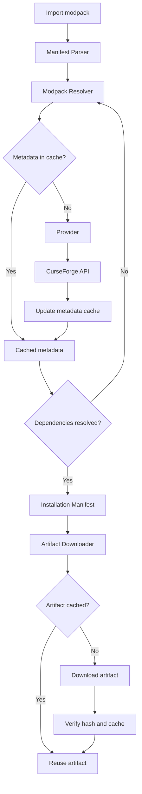
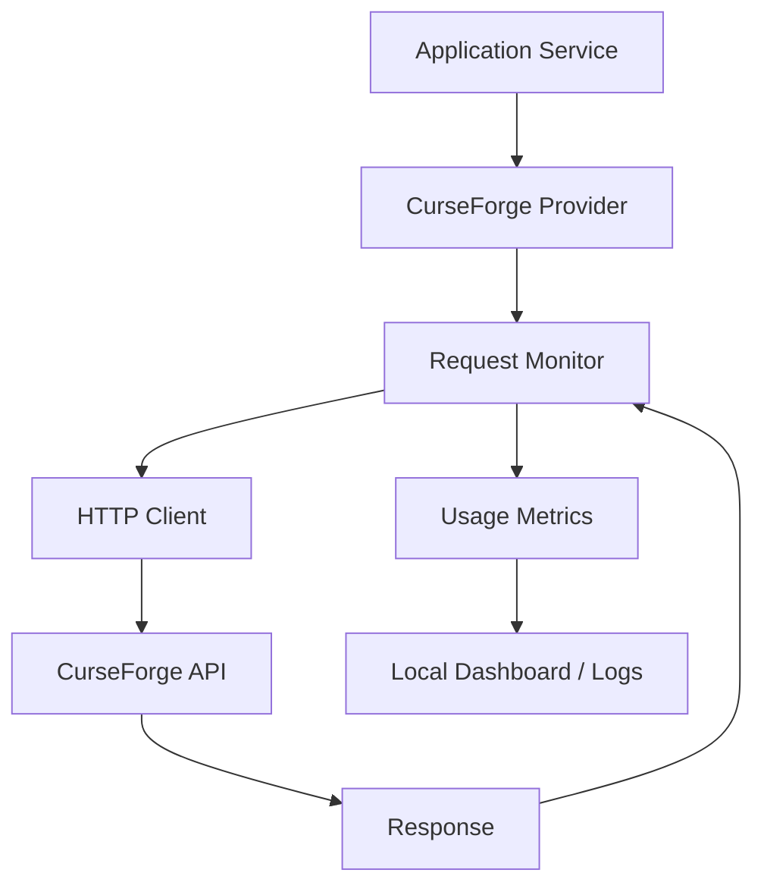

# Chat transcript

*This transcript contains the visible user and assistant messages in this conversation. Internal tool calls and system/developer instructions are omitted.*

---

## User
Are you able to pull issues from github repo with filters by labels? That's basically yes or no question

## Assistant
Yes.

## User
Great. I want you to pull github issue from this repo: https://github.com/squonkiest/Private-Modpack-Setup with label API.
API will be build using C#.
This chat is basically for planning and investigating available mechanisms and solutions as well as general help with development.
Also, read the readme and pull other tasks by your choice if needed for the full context.
General folder structure was suggested in other chat by AI:

```text
minecraft-platform/
├── apps/
│   ├── web/
│   │   ├── src/
│   │   ├── public/
│   │   ├── tests/
│   │   ├── package.json
│   │   └── README.md
│   └── backend/
│       ├── src/
│       │   ├── Api/
│       │   ├── Application/
│       │   ├── Domain/
│       │   ├── Infrastructure/
│       │   └── Program.cs
│       ├── tests/
│       └── README.md
├── components/
│   ├── providers/
│   │   ├── curseforge/
│   │   └── modrinth/
│   ├── modpack/
│   │   ├── resolver/
│   │   ├── cache/
│   │   └── manifests/
│   ├── installer/
│   │   ├── builder/
│   │   ├── runtime/
│   │   └── tests/
│   └── instance-manager/
│       ├── src/
│       ├── tests/
│       └── README.md
├── deploy/
│   ├── docker/
│   │   ├── compose.yaml
│   │   ├── backend.Dockerfile
│   │   ├── web.Dockerfile
│   │   └── minecraft-server.Dockerfile
│   └── config/
├── tests/
│   ├── integration/
│   └── end-to-end/
├── docs/
│   ├── architecture/
│   ├── development/
│   └── deployment/
├── scripts/
├── .github/
│   └── workflows/
├── .gitignore
├── .editorconfig
├── LICENSE
└── README.md
```

My current idea is to get understanding of how to implement providers.

It's not a strict rule to implement it by myself, existing one can be used also.

Provider should be able to provide as much information as possible about mods and modpacks initially. This includes, but not limited to: mod/modpack version, modloader, modloader version, name, last time updated, artifacts (.jar).

One of the important parts of this project is to be able to resolve dependencies from a curseforge manifest or other support file that declares mods. Provider is not forced to resolve it however and such mechanism can be implemented in other place. The problem is that I should somehow understand what are the dependencies of the specific version.

I will try to cache as much information as possible. This will be done in order to not hit API limits. And so, even if provider is able to resolve dependencies - it should firstly check cache. This limitation may be overcome with the API who will catch all the requests and decide what to do (serve or redirect), but this will make the whole implementation a bit convoluted and not as straightforward as I would like. Because of this, I need to find a relatively simple solution or implement my own, which will be run inside the docker container.

## User
I have installed plugin that you asked for (Github). Try again.

## Assistant
I've accessed the GitHub repository and retrieved its README, all issues, and the issues matching the `API` label.

I'll use **Private-Modpack-Setup** as the project context for this conversation. The primary focus here will be backend architecture, C# implementation, provider integrations, technical research, and evaluating implementation alternatives.

Repository: https://github.com/squonkiest/Private-Modpack-Setup

### 1. Project context

The README describes a private, non-commercial Minecraft modpack setup tool for your home lab.

The intended workflow is:

1. Submit a CurseForge modpack URL.
2. Retrieve modpack metadata and resolve its files.
3. Prepare a client installation.
4. Optionally prepare and deploy a dedicated server.
5. Distribute the prepared installation over the local network.
6. Manage server instances through Docker.

One discrepancy: the README still says that no repository has been created and development hasn't started. The repository and its issue tracker now exist, so that part of the README is outdated.

### 2. Issues with the `API` label

I retrieved the following 12 issues.

| Issue | Title |
|---|---|
| [#10](https://github.com/squonkiest/Private-Modpack-Setup/issues/10) | BE-1 — Backend project and configuration |
| [#11](https://github.com/squonkiest/Private-Modpack-Setup/issues/11) | BE-2 — CurseForge provider integration |
| [#12](https://github.com/squonkiest/Private-Modpack-Setup/issues/12) | BE-3 — Modpack URL parsing |
| [#13](https://github.com/squonkiest/Private-Modpack-Setup/issues/13) | BE-4 — Modpack metadata retrieval |
| [#14](https://github.com/squonkiest/Private-Modpack-Setup/issues/14) | BE-5 — Modpack file resolution |
| [#15](https://github.com/squonkiest/Private-Modpack-Setup/issues/15) | BE-6 — Shared mod file cache |
| [#16](https://github.com/squonkiest/Private-Modpack-Setup/issues/16) | BE-7 — Modpack library persistence |
| [#17](https://github.com/squonkiest/Private-Modpack-Setup/issues/17) | BE-8 — Installer generation |
| [#18](https://github.com/squonkiest/Private-Modpack-Setup/issues/18) | BE-9 — Backend endpoints |
| [#19](https://github.com/squonkiest/Private-Modpack-Setup/issues/19) | BE-10 — Instance management orchestration |
| [#20](https://github.com/squonkiest/Private-Modpack-Setup/issues/20) | BE-11 — Error handling and logging |
| [#21](https://github.com/squonkiest/Private-Modpack-Setup/issues/21) | BE-12 — Automated backend tests |

The most immediately relevant issues for our current discussion are **#11, #13, #14 and #15**.

### 3. Other issues relevant to the backend

I also retrieved the wider issue tracker. These are the issues I'd keep in our working context:

| Issue | Why it matters |
|---|---|
| [#22](https://github.com/squonkiest/Private-Modpack-Setup/issues/22) | Docker integration |
| [#23](https://github.com/squonkiest/Private-Modpack-Setup/issues/23) | Instance configuration and persistence |
| [#30](https://github.com/squonkiest/Private-Modpack-Setup/issues/30) | Host-wide resource limits |
| [#31](https://github.com/squonkiest/Private-Modpack-Setup/issues/31) | Per-instance CPU and RAM limits |
| [#32](https://github.com/squonkiest/Private-Modpack-Setup/issues/32) | Recovery and state reconciliation |
| [#34](https://github.com/squonkiest/Private-Modpack-Setup/issues/34) | Backend/UI model mapping |
| [#37](https://github.com/squonkiest/Private-Modpack-Setup/issues/37) | Complete CurseForge-to-server integration |
| [#38](https://github.com/squonkiest/Private-Modpack-Setup/issues/38) | LAN-only access |

In particular, #37 is important because it represents the eventual integration test for the functionality we're discussing.

### 4. Initial investigation: CurseForge provider capabilities

There is an important distinction between retrieving project metadata, retrieving file metadata, and actually downloading artifacts.

The official [CurseForge Core API documentation](https://docs.curseforge.com/rest-api/) exposes several relevant endpoints.

| Endpoint | Purpose |
|---|---|
| `GET /v1/mods/{modId}` | Retrieve project information |
| `GET /v1/mods/{modId}/files` | Retrieve available versions |
| `GET /v1/mods/{modId}/files/{fileId}` | Retrieve specific file metadata |
| `POST /v1/mods/files` | Retrieve multiple files by ID |
| `GET /v1/mods/{modId}/files/{fileId}/download-url` | Resolve download URL |

One particularly interesting discovery is that **file metadata already contains dependency information**.

The file response includes:

- `dependencies`: dependency project IDs and relation types.
- `gameVersions`: supported Minecraft versions.
- `sortableGameVersions`: additional version information.
- `fileDate`: publication date.
- `hashes`: file hashes.
- `fileLength`: file size.
- `fileName`: original filename.
- `isServerPack`: whether the file represents a server pack.
- `serverPackFileId`: associated server pack file, when available.
- `downloadUrl`: download reference.

This is directly relevant to your dependency-resolution problem. You don't necessarily need to discover dependencies by inspecting JAR files. CurseForge exposes dependency metadata through its API.

There is also a recent download authentication change worth accounting for: CurseForge announced that API-key authentication for direct CDN downloads would become mandatory on July 16, 2026. Since we're now past that date, the implementation should account for authenticated downloads.

### 5. Architectural direction I'd investigate

I would avoid making the provider responsible for the entire modpack resolution process.

Instead, I'd separate three responsibilities:

**Provider integration**

Responsible for communicating with CurseForge (and eventually Modrinth).

It should retrieve:
- Projects and their metadata.
- Available versions.
- Specific version metadata.
- Dependencies declared by a specific version.
- Download references.
- Artifact information.

**Modpack resolver**

Responsible for interpreting manifests and constructing a complete installation plan.

It should:
- Parse CurseForge manifests.
- Identify declared projects and versions.
- Retrieve missing metadata through providers.
- Resolve dependencies.
- Identify unavailable files.
- Produce a normalized installation manifest.

**Cache**

Responsible for avoiding unnecessary provider requests and downloads.

I would distinguish two kinds of cache:

1. Metadata cache: project information, versions, dependencies, file metadata.
2. Artifact cache: actual downloaded JARs and other installation files.

These have different expiration and integrity requirements. Metadata can become stale; an artifact identified by a reliable hash can generally be reused indefinitely.

### Proposed request flow



This approach doesn't require a separate proxy API that intercepts provider requests. The cache is simply a dependency of the provider-facing application services.

### 6. My recommendation for the C# implementation

I'd start with a relatively small abstraction rather than designing a comprehensive provider framework.

For example:

```csharp
public interface IModpackProvider
{
    Task<Modpack?> GetModpackAsync(
        string projectId,
        CancellationToken cancellationToken);

    Task<IReadOnlyCollection<ModpackVersion>> GetVersionsAsync(
        string projectId,
        CancellationToken cancellationToken);

    Task<ModpackVersion?> GetVersionAsync(
        string projectId,
        string versionId,
        CancellationToken cancellationToken);
}

public interface IModProvider
{
    Task<Mod?> GetModAsync(
        string projectId,
        CancellationToken cancellationToken);

    Task<ModVersion?> GetVersionAsync(
        string projectId,
        string versionId,
        CancellationToken cancellationToken);

    Task<IReadOnlyCollection<ModDependency>> GetDependenciesAsync(
        string projectId,
        string versionId,
        CancellationToken cancellationToken);

    Task<DownloadReference?> GetDownloadReferenceAsync(
        string projectId,
        string versionId,
        CancellationToken cancellationToken);
}
```

These are illustrative contracts, not something I'd commit to yet. We should first investigate whether modpacks and individual mods can share a common abstraction without losing provider-specific capabilities.

I'd also investigate existing C# libraries before implementing HTTP clients ourselves. However, I'd avoid introducing a large dependency just to save a few API calls.

### One important design decision

I would put caching *outside* the provider implementation, preferably through a decorator or dedicated application service.

For example:

```text
Application
    |
    v
CachedModProvider
    |
    +----> MetadataCache
    |
    v
CurseForgeProvider
    |
    v
CurseForge API
```

This means:
- Providers don't need to know where or how data is cached.
- Every provider benefits from the same caching mechanism.
- Cache policies can be changed independently.
- We can test provider behavior separately from caching.
- The application controls when stale data should be refreshed.

It also avoids coupling providers to a particular database or cache implementation.

### 7. Suggested investigation order

I'd approach the work in this order:

1. **CurseForge API capabilities:** Determine exactly what information can be retrieved and through which endpoints.
2. **Existing implementations:** Investigate available C# libraries and other open-source CurseForge integrations.
3. **Data model:** Establish a normalized representation of projects, versions, dependencies and artifacts.
4. **Dependency resolution:** Determine how to combine manifest-declared files with provider-retrieved dependencies.
5. **Caching:** Design metadata and artifact caching policies.
6. **Proof of concept:** Implement actual API calls using your CurseForge credentials and real responses.

I would not start with the database, API controllers or frontend contracts yet.

The first milestone should be understanding whether we can reliably resolve a real CurseForge modpack into a complete list of required files.

## User
1. Tasks were not reviewed. Using their basic description you can understand the work that should be done, but some requirement can be missed on purpose. Like, any kind of testing or documentation. Since it's a private repo, it can be dropped for some time.
2. I've got an API key from Curseforge team via form. The only problem here - how can I know if I am about to hit a limit? Like, I would prefer to know or have some dashboard or endpoint to know that I am about to hit it. I don't want to have any sort of troubles with curseforge.
3. I agree with your vision. Provider is a simple source of information, if you can say so. It should not resolve or do anything meaningful on its own and just should be managed by a higher entity.

## Assistant
Agreed on all three points. There are a few architectural implications worth establishing before we start implementing anything.

### 1. GitHub issues are a work breakdown, not a complete specification

I'll treat issue descriptions and acceptance criteria as an initial outline of intended functionality, not as mandatory implementation requirements.

For example:
- Testing can be postponed while we're validating feasibility.
- Documentation can be limited to what's necessary for development.
- Acceptance criteria can change as we discover technical constraints.
- We shouldn't implement abstractions merely because an issue happens to suggest them.

The important distinction is between **what the application needs to do** and **what engineering practices we eventually want around it**.

### 2. Provider responsibilities

I agree with your definition: a provider is essentially a source of information.

I'd make this a fairly strict architectural boundary:

- Provider communicates with an external service.
- Provider translates external responses into application-level data structures.
- Provider exposes available information.
- Provider does not decide how the application uses that information.
- Provider does not own dependency resolution, caching policy, installation planning or persistence.

The higher-level application services orchestrate those operations.

This also means a provider should ideally be stateless, apart from its HTTP infrastructure and configuration.

## Assistant
### 3. CurseForge API limits: an important finding

This is the part I'd investigate before writing the provider.

I checked the official API documentation and the third-party API terms.

**I couldn't find a publicly documented request quota, rate-limit endpoint, or usage dashboard for third-party API keys.**

The documentation specifies authentication through `x-api-key`, but doesn't document rate-limit headers or a rate-limit endpoint.

There is, however, an important distinction between two types of limits.

**A. Technical rate limits**

These determine how frequently you can call the API.

Normally, an API might expose headers such as:

| Header | Purpose |
|---|---|
| `X-RateLimit-Limit` | Maximum requests |
| `X-RateLimit-Remaining` | Remaining requests |
| `X-RateLimit-Reset` | Reset time |
| `Retry-After` | How long to wait |

I haven't found confirmation that CurseForge exposes these headers. We should inspect actual responses rather than assume they exist.

**B. Account/application quota**

This is potentially more important.

The published third-party API terms explicitly state that Overwolf can establish and change quotas at its discretion. Exceeding the quota can require a separate licensing agreement.

This is not necessarily the same thing as receiving HTTP 429 after too many requests.

### What I'd do

I'd contact the CurseForge team directly and ask them to clarify the following:

1. What is the current API quota assigned to my key?
2. Is it measured per minute, hour, day, or month?
3. Is there a dashboard or endpoint for monitoring consumption?
4. Are rate-limit headers included in API responses?
5. What happens when the assigned quota is approached or exceeded?
6. Are there separate quotas for metadata requests and file downloads?

I'd also ask whether they can provide a warning mechanism before reaching the assigned quota.

You already have an approved key, so this is a reasonable technical clarification rather than another application.

## Assistant
### 4. One issue with the caching proposal

I found something important in the published terms that we need to resolve.

Section 3.1 of the third-party API terms explicitly prohibits saving or caching data obtained through the API or SDK.

This directly conflicts with our proposed metadata cache.

I would not implement persistent CurseForge metadata caching until the team confirms whether your approved application has an exception or whether the terms have changed for your particular agreement.

This doesn't necessarily prevent us from caching downloaded artifacts, but that also needs clarification.

It's particularly important because caching was supposed to be one of the primary mechanisms for reducing API usage.

## Assistant
### 5. Proposed monitoring architecture

Regardless of whether CurseForge provides usage headers, I'd implement our own request accounting.



The monitor would record:

- Total requests.
- Requests grouped by endpoint.
- Successful and failed requests.
- HTTP status codes.
- Response latency.
- Rate-limit headers, if available.
- Retry attempts.
- Provider errors.

This gives us visibility into our consumption even without an official dashboard.

However, our local accounting cannot tell us the actual remaining quota unless CurseForge provides that information.

---

### 6. Next step

I'd prioritize getting clarification from CurseForge before designing the caching mechanism.

Here is a draft message:

**Subject: Questions regarding API quota and usage monitoring**

Hello CurseForge Team,

Thank you for providing API access for my project.

I'm currently working on the implementation and would like to clarify a few technical details to ensure that my application operates within the permitted API usage limits.

Specifically:

1. What request quota is currently assigned to my API key?
2. Is there a dashboard or API endpoint that allows me to monitor current API consumption?
3. Does the API expose rate-limit headers, such as remaining requests or reset time?
4. Is there a recommended way to detect that an application is approaching its assigned quota?
5. Are there separate quotas for metadata requests and file downloads?

I would also appreciate clarification regarding caching. My application would benefit from caching metadata and downloaded artifacts to reduce redundant API requests and downloads. Are these caching mechanisms permitted under my API access agreement, or are there specific restrictions I should follow?

The application is a private, non-commercial home-lab project used to prepare Minecraft modpack installations for personal multiplayer sessions.

I want to ensure that the implementation respects your API usage policies and does not generate unnecessary traffic.

Thank you for your assistance.

**My position:** Let's keep investigating provider capabilities and data models, but hold off on implementing persistent caching until we have an explicit answer about the terms. This is a constraint that could materially change our architecture.

## User
Selected text:

> Section 3.1 of the third-party API terms explicitly prohibits saving or caching data obtained through the API or SDK.

My request:
State exact line that forbids such

## Assistant
The exact wording is in **Section 3 — Restrictions and Obligations of Developer, subsection 1, line 62** of the CurseForge 3rd Party API Terms and Conditions.

> Developer shall not, and shall not allow any third party, to [...] **(e) save or cache any data obtained through the API or SDK.**

The relevant sentence is at the very end of subsection 3.1.

**Important distinction:** The wording explicitly prohibits saving or caching data obtained through the API or SDK. It does not explicitly distinguish between temporary in-memory caching, persistent metadata storage, or downloaded artifacts.

Therefore, I would ask CurseForge for clarification before concluding that all forms of caching, including downloaded JAR files, are prohibited.

## User
It's some bs. Think about this - you are giving to the user a specific api key, that allows you to access information about mods and downloaded said mods. If you are able to download, then you are automatically saving it somewhere. So, this is logically cannot be applied. More than that I described the project when I was applying in the form and caching was also mentioned "Any local caching or transfer would be limited to preparing installations for our private gaming sessions.". By approving this key, they already granted me an ability to dishonor this section to some extent. That extent is - for private usage (no distribution, no competing, no distribution, no monetization at all and downloaded strictly by mechanisms provided by the curseforge).

## Assistant
Your interpretation has a reasonable basis, but I'd separate two things: what the API necessarily permits you to do and what the terms explicitly authorize.

I think the important detail is that your application was not approved in a vacuum. You described its intended functionality, including local caching and transfer for private gaming sessions. CurseForge then issued you an API key.

That is relevant context when interpreting the scope of the approval.

There is, however, a distinction between:

1. **Technical permission:** Your key allows you to retrieve metadata and download files.
2. **Intended use:** You disclosed that files would be stored locally to prepare private installations.
3. **Contractual permission:** Whether the approval constitutes an exception to the general restrictions in the API terms.

The first two are reasonably clear from what you've described. The third is what I'd avoid treating as conclusively established without confirmation.

There is one technical distinction worth making, though. The API returns download references, while the actual JAR is retrieved from CurseForge's download infrastructure. That gives us a reasonable basis to distinguish between:

- Downloading and storing mod artifacts as part of preparing an installation.
- Persistently caching API metadata, such as project descriptions, version lists and dependency information.
- Redistributing downloaded files independently of the CurseForge installation workflow.

These are not necessarily treated identically by the terms.

The terms also contain an entire-agreement clause in Section 12.3, so merely issuing an API key does not automatically establish a contractual exception. However, if your approval correspondence explicitly acknowledges the described caching and private-installation workflow, that is materially stronger evidence.

### What this means for our architecture

I would proceed on the following working assumptions:

| Operation | Project requirement |
|---|---|
| Download JAR files through CurseForge-provided mechanisms | Required |
| Store downloaded JARs locally | Required |
| Reuse downloaded files across installations | Required |
| Cache mod and modpack metadata | Desired |
| Resolve dependencies locally using available metadata | Desired |
| Distribute installations privately to your own clients | Required |
| Public mod distribution | Out of scope |

I would not abandon caching or redesign the application around a proxy just because of that clause.

Instead, I'd keep the architecture we discussed and clarify the permitted scope with CurseForge if necessary.

## User
So, let's end discussion about terms of usage.
My general logic is next: Curseforge doesn't want you to store any information in case of distribution. The logic is simple, if you distribute mods from your local cache - author does not get any credit. I think it is a simple as that. There are may be other reason, but I think those are strongly connected.
My project is an exception. (1) Curseforge team knows about the description of this project. (2) It's a non-commercial project. (3) It will not distribute content for wide audience. (4) Storing and caching even benefits curseforge because I am not putting as much stress on their system. (5) The project may benefit authors in the same way. If you noticed, the repo is public and I am planning to keep it this way. So, if someone will find it useful to test modpacks (authors), then they will benefit from this solution as well.

## Assistant
Understood. We'll consider the terms-of-usage discussion closed and use your stated project scope as the working assumption going forward.

Your reasoning also identifies an important distinction: **private caching for installation purposes is fundamentally different from operating an alternative mod distribution platform.**

The project has several characteristics that distinguish it from the latter:

- **Limited audience:** You, your girlfriend and a small group of friends.
- **Non-commercial:** No monetization or commercial distribution.
- **Attribution and provenance:** Files originate from CurseForge and are obtained through its intended download mechanisms.
- **Reduced API traffic:** Reusing previously retrieved information and artifacts avoids unnecessary requests.
- **Potential community benefit:** The public repository could help modpack authors reproduce installations and test their packs.

I particularly agree with keeping the repository public. Open-sourcing the implementation doesn't mean making its hosted content publicly accessible. Those are separate concerns.

For our technical design, I'll use these assumptions:

1. Metadata caching is part of the architecture.
2. Downloaded artifacts are stored locally and reused.
3. All downloads use provider-supported mechanisms.
4. No public mod or modpack distribution functionality is planned.
5. The provider remains a passive data-access layer.
6. Higher-level services own caching, resolution and installation orchestration.

We can move on to the actual engineering problems without repeatedly revisiting this discussion.

## User
Can you dump the transcript of this chat?
